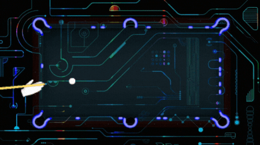

  

#

Olá! Me chamo William, tenho 43 anos e moro em Taguatinga - DF. Sou formado em  Análise e Desenvolvimento de Sistemas e atualmente trabalho como Desenvolvedor Full Stac Freelancer
 
#

<h3 align="left">🌐 Conecte-se Comigo</h3>

 
  
  
   
  

<h3 align="left">🛠️ Tecnologias e Ferramentas</h3>

 
  
  
  
  
  
  

<h3 align="left">📊 Minhas Estatísticas</h3>

  

<picture align="center">
  <source media="(prefers-color-scheme: dark)" srcset="https://raw.githubusercontent.com/WillPereir4/WillPereir4/output/github-contribution-grid-snake-dark.svg">
  <source media="(prefers-color-scheme: light)" srcset="https://raw.githubusercontent.com/WillPereir4/WillPereir4/output/github-contribution-grid-snake-dark.svg">
  
</picture>
